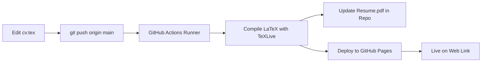

# 📄 Manan Chahal — Resume & CV

[](https://mananch1.github.io/Resume/)
[](https://mananch1.github.io/Resume/Resume.pdf)
[](https://github.com/mananch1/Resume/actions/workflows/deploy.yml)

Automated LaTeX CV and interactive web viewer for **Manan Chahal**. Any changes made to [`cv.tex`](cv.tex) are automatically compiled using TeXLive in GitHub Actions and immediately published to GitHub Pages.

---

## 🔗 Live Links

* 🌐 **Interactive Web Viewer:** [https://mananch1.github.io/Resume/](https://mananch1.github.io/Resume/)
* 📥 **Direct PDF Link:** [https://mananch1.github.io/Resume/Resume.pdf](https://mananch1.github.io/Resume/Resume.pdf)
* 🐙 **GitHub Profile:** [https://github.com/mananch1](https://github.com/mananch1)

---

## ⚡ How It Works (Automated CI/CD)



1. **LaTeX Source:** All resume content is maintained in [`cv.tex`](cv.tex).
2. **Automated Build:** On every `push` to `main`, GitHub Actions triggers `.github/workflows/deploy.yml`.
3. **TeXLive Compilation:** The action compiles `cv.tex` directly to `Resume.pdf`.
4. **Auto-commit PDF:** The newly compiled `Resume.pdf` is automatically committed back to the repository root.
5. **Web Deployment:** The responsive interactive viewer (`index.html`) and the new PDF are deployed live to GitHub Pages.

---

## ✏️ How to Update Your Resume

Whenever you want to make an update:

1. Open and edit [`cv.tex`](cv.tex).
2. Commit and push your changes:
   ```bash
   git add cv.tex
   git commit -m "Update: Add new project / experience"
   git push origin main
   ```
3. Within 1–2 minutes, GitHub Actions will compile your updated resume and refresh the live weblink automatically!

---

## ⚙️ One-Time Setup for GitHub Pages

To make the weblink active on your GitHub repository:

1. Open your repository on GitHub: [https://github.com/mananch1/Resume](https://github.com/mananch1/Resume)
2. Go to **Settings** > **Pages** (or direct link: [https://github.com/mananch1/Resume/settings/pages](https://github.com/mananch1/Resume/settings/pages))
3. Under **Build and deployment** > **Source**:
   * Select **GitHub Actions** *(Recommended)*
   * *Alternatively*, you can choose **Deploy from a branch** and select `gh-pages` (or `main`) with `/ (root)`.
4. Your resume is now live at:
   👉 **[https://mananch1.github.io/Resume/](https://mananch1.github.io/Resume/)**

---

## 📁 Repository Structure

```
├── .github/workflows/
│   └── deploy.yml       # GitHub Actions workflow for LaTeX compile & Pages deploy
├── .gitignore           # Ignores LaTeX intermediate/auxiliary files
├── cv.tex               # Primary LaTeX resume source code
├── index.html           # Responsive web viewer with download & print controls
├── Resume.pdf           # Compiled PDF resume
└── README.md            # Repository documentation
```
